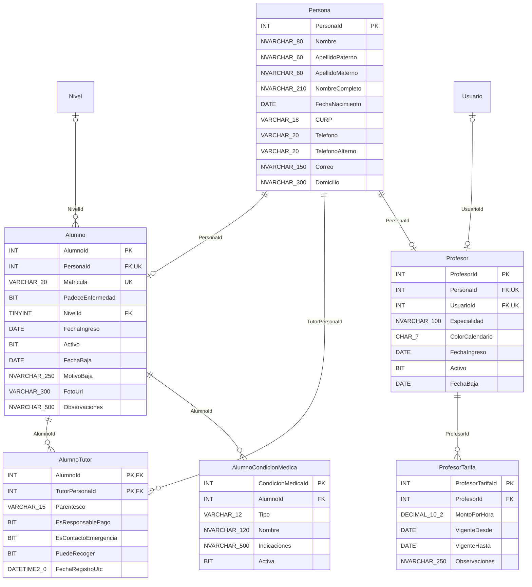
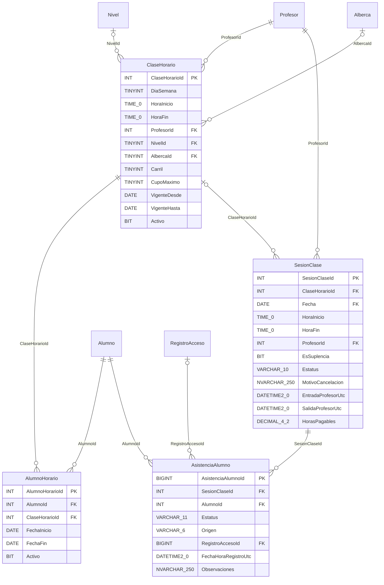
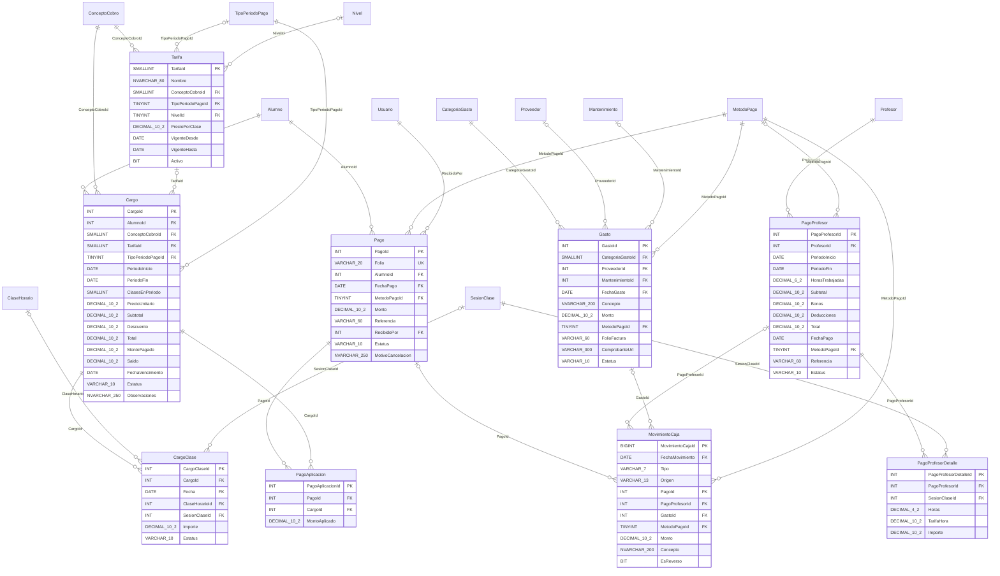
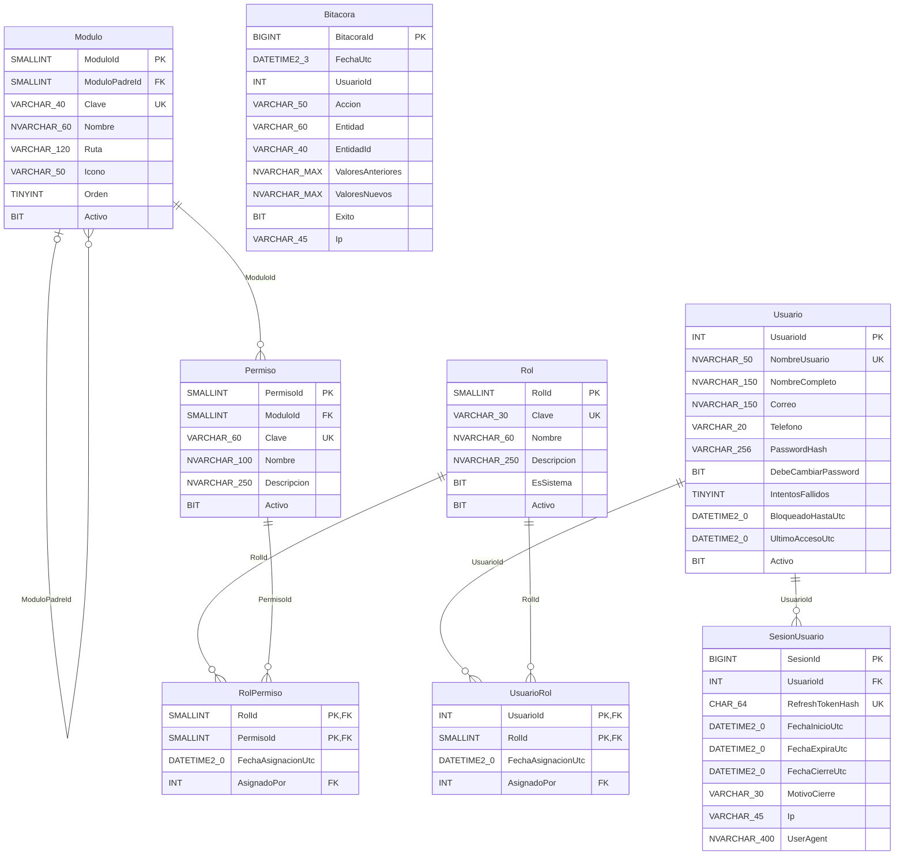
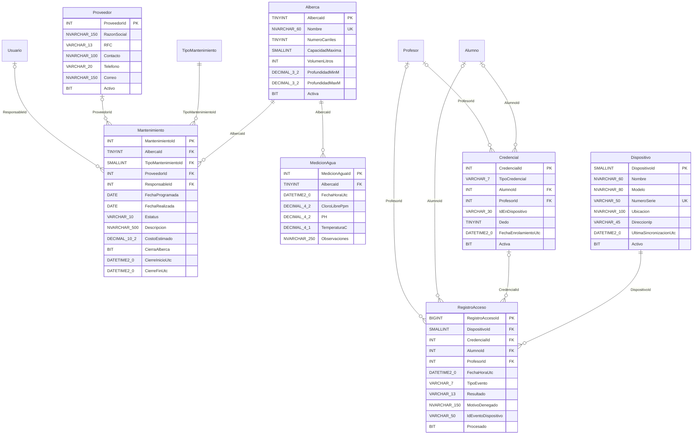
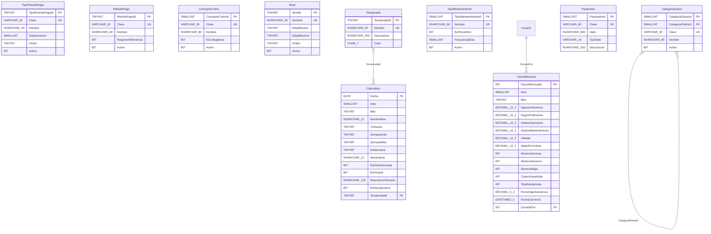

# Acuatica.Valle.Database

Base de datos del **Sistema de gestión de la escuela de natación Acuática Valle**: alumnos, horarios, asistencias, pagos, profesores, roles y permisos, con soporte para lector de huella, gastos, mantenimiento de la alberca y reportes financieros.

| | |
|---|---|
| **Motor** | SQL Server 2019+ / Azure SQL |
| **Versión del modelo** | 1.2 (octubre 2026) |
| **Tamaño** | 44 tablas en 10 esquemas |
| **Diagrama editable** | [`Documentacion/ER_Acuatica_Valle_v1.2.drawio`](Documentacion/ER_Acuatica_Valle_v1.2.drawio) (diagrams.net) |
| **Notas de mejora** | [`Documentacion/Notas_de_Mejoras_v1.2.docx`](Documentacion/Notas_de_Mejoras_v1.2.docx) (Word) |
| **Base funcional** | Levantamiento de requerimientos v1.0.0 (07/03/2026), notas del 09/03/2026 y diseño en Figma |

## Contenido

- [Estructura del repositorio](#estructura-del-repositorio)
- [Diagrama entidad-relación](#diagrama-entidad-relación)
- [Esquemas](#esquemas)
- [Convenciones](#convenciones)
- [Reglas de negocio](#reglas-de-negocio)
- [Origen de los indicadores](#origen-de-los-indicadores)
- [Decisiones del cliente](#decisiones-del-cliente)
- [Pendientes por confirmar](#pendientes-por-confirmar)
- [Diccionario de datos](#diccionario-de-datos)
- [Historial de versiones](#historial-de-versiones)

## Estructura del repositorio

```
Acuatica.Valle.Database/
├─ README.md                                  ← este documento
└─ Documentacion/
   ├─ ER_Acuatica_Valle_v1.2.drawio           ← diagrama entidad-relación (diagrams.net)
   └─ Notas_de_Mejoras_v1.2.docx              ← mejoras y optimizaciones propuestas
```

## Diagrama entidad-relación

El diagrama completo, con todas las columnas, tipos de datos y cardinalidades, está en [`Documentacion/ER_Acuatica_Valle_v1.2.drawio`](Documentacion/ER_Acuatica_Valle_v1.2.drawio).

**Cómo abrirlo:**

1. Entra a <https://app.diagrams.net> o abre draw.io Desktop.
2. Ve a **Archivo → Abrir desde → Dispositivo** y elige el archivo `.drawio`.
3. Cada esquema es un contenedor de color. Si pasas el mouse sobre el título de una tabla, verás su descripción.

**Leyenda del diagrama:**

- `PK` llave primaria · `FK` llave foránea · `UQ` valor único.
- Un tipo con `NULL` es una columna opcional; sin `NULL`, la columna es obligatoria.
- Los renglones grises en cursiva son de auditoría. Sus relaciones hacia `Seguridad.Usuario` no se dibujan, para no saturar el diagrama.
- Tampoco se dibujan las relaciones de fecha hacia `Reporte.Calendario`.

Los diagramas siguientes se dibujan automáticamente en GitHub y Azure DevOps. Están divididos por área para que se puedan leer. Cada uno muestra las columnas de sus tablas, sin las de auditoría; las tablas de otras áreas aparecen solo con su nombre. Mermaid no admite paréntesis en los tipos, así que `NVARCHAR_80` significa `NVARCHAR(80)` y `DECIMAL_10_2` significa `DECIMAL(10,2)`.

### 1. Personas, alumnos y profesores



### 2. Horarios, clases y asistencia



### 3. Cobros, pagos y caja



### 4. Seguridad: usuarios, roles y permisos



### 5. Operación (alberca) y control de acceso (huella)



### 6. Catálogos y reportes



## Esquemas

| Esquema | Tablas | Qué guarda |
|---|---|---|
| `Seguridad` | [Usuario](#seguridadusuario), [Rol](#seguridadrol), [UsuarioRol](#seguridadusuariorol), [Modulo](#seguridadmodulo), [Permiso](#seguridadpermiso), [RolPermiso](#seguridadrolpermiso), [SesionUsuario](#seguridadsesionusuario), [Bitacora](#seguridadbitacora) | Usuarios, roles, permisos por módulo, sesiones y bitácora. |
| `Catalogo` | [TipoPeriodoPago](#catalogotipoperiodopago), [MetodoPago](#catalogometodopago), [ConceptoCobro](#catalogoconceptocobro), [Nivel](#catalogonivel), [CategoriaGasto](#catalogocategoriagasto), [TipoMantenimiento](#catalogotipomantenimiento), [Temporada](#catalogotemporada), [Parametro](#catalogoparametro) | Catálogos configurables y parámetros del sistema. |
| `Personas` | [Persona](#personaspersona) | Datos personales únicos (alumno, tutor o profesor). |
| `Alumnos` | [Alumno](#alumnosalumno), [AlumnoTutor](#alumnosalumnotutor), [AlumnoCondicionMedica](#alumnosalumnocondicionmedica) | Alumnos, tutores de menores y condiciones médicas. |
| `Personal` | [Profesor](#personalprofesor), [ProfesorTarifa](#personalprofesortarifa) | Profesores y su tarifa por hora. |
| `Clases` | [ClaseHorario](#clasesclasehorario), [AlumnoHorario](#clasesalumnohorario), [SesionClase](#clasessesionclase), [AsistenciaAlumno](#clasesasistenciaalumno) | Horarios, inscripciones, clases impartidas y asistencia. |
| `Finanzas` | [Tarifa](#finanzastarifa), [Cargo](#finanzascargo), [CargoClase](#finanzascargoclase), [Pago](#finanzaspago), [PagoAplicacion](#finanzaspagoaplicacion), [PagoProfesor](#finanzaspagoprofesor), [PagoProfesorDetalle](#finanzaspagoprofesordetalle), [Gasto](#finanzasgasto), [MovimientoCaja](#finanzasmovimientocaja) | Tarifas, cargos, pagos de alumnos, nómina de profesores, gastos y caja. |
| `Operacion` | [Alberca](#operacionalberca), [Proveedor](#operacionproveedor), [Mantenimiento](#operacionmantenimiento), [MedicionAgua](#operacionmedicionagua) | Albercas, proveedores, mantenimiento y calidad del agua. |
| `Acceso` | [Dispositivo](#accesodispositivo), [Credencial](#accesocredencial), [RegistroAcceso](#accesoregistroacceso) | Lector de huella / control de entradas y salidas. |
| `Reporte` | [Calendario](#reportecalendario), [CierreMensual](#reportecierremensual) | Dimensión calendario (temporadas) y cierres mensuales. |

### Cobertura de requerimientos

| Requerimiento / pantalla | Tablas |
|---|---|
| RFN01 Control de alumnos · Detalles del alumno | `Personas.Persona`, `Alumnos.Alumno`, `Alumnos.AlumnoTutor`, `Alumnos.AlumnoCondicionMedica` |
| RFN02 Registro de horario | `Clases.ClaseHorario`, `Clases.AlumnoHorario` |
| RFN03 Información de pagos | `Finanzas.Tarifa`, `Finanzas.Cargo`, `Finanzas.CargoClase`, `Finanzas.Pago`, `Finanzas.PagoAplicacion`, `Catalogo.TipoPeriodoPago`, `Catalogo.MetodoPago` |
| RFN04 Profesores y calendario | `Personal.Profesor`, `Personal.ProfesorTarifa`, `Clases.ClaseHorario`, `Clases.SesionClase` |
| RFN04 Registrar asistencia | `Clases.AsistenciaAlumno` (manual o por huella) |
| RFN05 Dashboard | Ver [Origen de los indicadores](#origen-de-los-indicadores) |
| RFN06 Reportes | `Finanzas.MovimientoCaja`, `Finanzas.PagoProfesor`, `Reporte.Calendario`, `Reporte.CierreMensual` |
| RSN01 Configuración: usuarios, contraseñas, roles y permisos | Esquema `Seguridad` |
| Lector de huella | Esquema `Acceso` |
| Gastos, mantenimiento de la alberca, entradas y salidas, temporadas bajas | `Finanzas.Gasto`, `Finanzas.MovimientoCaja`, esquema `Operacion`, `Reporte.Calendario`, `Catalogo.Temporada` |

## Convenciones

**Organización y nombres**

- **Esquemas por dominio** en lugar de `dbo`, para dar permisos por esquema y ubicar las tablas rápido.
- Tablas en **español, singular y PascalCase**.
- La llave primaria se llama `<Tabla>Id`.
- La llave foránea se llama igual que la PK a la que apunta, salvo cuando el nombre indica un rol: `TutorPersonaId`, `RecibidoPor`, `ResponsableId`.

**Tipos de datos**

| Uso | Tipo |
|---|---|
| Identificadores | `INT IDENTITY`. `BIGINT` en tablas de alto volumen (`AsistenciaAlumno`, `RegistroAcceso`, `MovimientoCaja`, `Bitacora`, `SesionUsuario`). `TINYINT`/`SMALLINT` en catálogos. |
| Dinero | `DECIMAL(10,2)` y `DECIMAL(12,2)` en acumulados. Nunca `FLOAT` ni `MONEY`. |
| Texto | `NVARCHAR` (acentos y ñ). `VARCHAR`/`CHAR` para códigos, teléfonos, CURP, RFC y hashes. |
| Fechas | `DATE` para fechas de negocio, `TIME(0)` para horas de clase, `DATETIME2(0)` en **UTC** para eventos y auditoría. |
| Estados fijos | `VARCHAR` con `CHECK` (ej. `'PENDIENTE','PARCIAL','PAGADO','CANCELADO'`), legibles en consultas. |

**Reglas de diseño**

- **Datos personales una sola vez:** nombre, nacimiento, teléfono y domicilio viven en `Personas.Persona`. Alumno, tutor y profesor son *roles* que apuntan a una Persona.
- **No se guarda la edad:** se guarda `FechaNacimiento`, y la edad y si es menor de edad se calculan.
- **Nada se borra físicamente:** se desactiva (`Activo = 0`) o se cancela (`Estatus = 'CANCELADO'`), para que los reportes históricos no cambien.
- **Auditoría:** las tablas principales llevan `FechaCreacionUtc`, `CreadoPor`, `FechaModificacionUtc` y `ModificadoPor`.
- **Concurrencia:** `RowVer` (`ROWVERSION`) en `Persona`, `Alumno`, `Profesor`, `Usuario` y `Cargo`, para que dos usuarios no se pisen al editar.
- **Precios congelados:** `Cargo.PrecioUnitario`, `CargoClase.Importe` y `PagoProfesorDetalle.TarifaHora` copian el precio vigente al momento. Un aumento de tarifa no altera lo ya cobrado o pagado.
- **Acceso a datos por stored procedures:** el prefijo `Qry` es para consultas y `Cmd` para comandos. Los que mueven dinero se ejecutan en **una sola transacción** con `SET XACT_ABORT ON`.

## Reglas de negocio

### 1. Personas, alumnos y tutores

- **Una persona se captura una sola vez.** Antes de crear una `Persona`, la aplicación busca por CURP, teléfono o nombre para reutilizar la existente. El CURP es único cuando existe.
- **Un alumno se registra sin pago** (nota del 09/03/2026). Basta con crear `Persona` y `Alumno`. `Alumno.PersonaId` es único: una persona tiene como máximo un registro de alumno.
- **El tutor solo se captura si el alumno es menor de edad**, calculado con `Persona.FechaNacimiento`, que es obligatoria para alumnos.
  - Si el alumno es menor, se exige al menos un registro en `AlumnoTutor`.
  - Si es mayor de edad, no se pide tutor.
- **El tutor es una `Persona`.**
  - Un padre o madre que también es alumno es la misma persona con dos roles.
  - Un tutor con varios hijos inscritos se registra una sola vez.
  - Si cambia de domicilio, se actualiza en un solo lugar.
- **Una persona no puede ser tutor de sí misma:** `AlumnoTutor.TutorPersonaId` debe ser distinto de `Alumno.PersonaId`. Esta regla la valida el stored procedure.
- **Datos médicos:** `PadeceEnfermedad = 1` exige al menos una fila activa en `AlumnoCondicionMedica`. Solo los roles con el permiso `alumnos.ver_datos_medicos` ven ese detalle.
- **Baja de un alumno:**
  - `Activo = 0`, con `FechaBaja` y `MotivoBaja`.
  - Se cierran sus inscripciones (`AlumnoHorario.Activo = 0`).
  - Se desactivan sus credenciales de acceso.
- **Matrícula:** la genera el sistema con una `SEQUENCE` (ej. `AV-000123`).

### 2. Horarios y calendario

- **`ClaseHorario` es el bloque recurrente del calendario:** día de la semana, hora de inicio y fin, profesor titular, alberca y cupo. `DiaSemana` va de 1 = lunes a 7 = domingo.
- **Registrar horario:** se inserta una fila en `AlumnoHorario` por cada día marcado. Solo se permite si los inscritos activos son menos que `CupoMaximo`.
- **`SesionClase` es cada clase real en una fecha.** Se genera a partir de `ClaseHorario`, solo en días con `Reporte.Calendario.EsDiaOperativo = 1`.
  - **Suplencia:** se cambia `ProfesorId` en la sesión y se marca `EsSuplencia = 1`.
  - **Cancelación** (clima, mantenimiento, festivo): `Estatus = 'CANCELADA'` con su motivo. No se paga al profesor y no cuenta como falta del alumno.
- **Dos horas seguidas** son dos `SesionClase` distintas. Cada una cuenta como una clase para asistencia y cobro.

### 3. Asistencia

- **Manual:** se registra en `AsistenciaAlumno` con `Origen = 'MANUAL'`, siempre ligada a una `SesionClase` (fecha y hora).
- **Por huella:**
  1. Cada checada se guarda en `Acceso.RegistroAcceso`. `IdEventoDispositivo` evita duplicados si el lector reenvía el evento.
  2. Un proceso busca la sesión del alumno ese día en la que cae la hora de la checada.
  3. Crea la asistencia con `Origen = 'HUELLA'`. Si llega después de `MINUTOS_TOLERANCIA_RETARDO`, la marca como `RETARDO`.
  4. Marca la checada con `Procesado = 1`.
- **Checadas de profesores:** llenan `SesionClase.EntradaProfesorUtc` y `SalidaProfesorUtc`.
- **Cierre del día:** a los inscritos sin registro se les crea una `FALTA`, para que el porcentaje de asistencia sea real.
- **Bloqueo por adeudo:** si el parámetro `BLOQUEAR_ACCESO_CON_ADEUDO = 1`, el lector niega la entrada a quien tenga adeudo vencido (`Resultado = 'DENEGADO'`).

### 4. Cobro a alumnos: por clase y por días reales

- **La tarifa es precio por clase de 1 hora** (`Finanzas.Tarifa.PrecioPorClase`), con vigencia. Puede variar por tipo de periodo y por nivel.
- **`Cargo` es lo que el alumno debe por un periodo. `CargoClase` es cada clase concreta que ese cargo cubre** (fecha y bloque).
  - **Clase suelta:** un cargo con 1 renglón. Se puede pagar el mismo día.
  - **Dos horas seguidas el mismo día:** 2 renglones.
  - **Semana, quincena o mes:** se cruzan los horarios del alumno con los días operativos reales del calendario. Si en el mes le tocan 4 clases, paga 4; si le tocan 13, paga 13. No se usa un factor fijo de 4 semanas.
- **Cálculo:**
  - `ClasesEnPeriodo` = número de renglones de `CargoClase`.
  - `Total = ClasesEnPeriodo × PrecioUnitario − Descuento`.
  - `Saldo = Total − MontoPagado` (columna calculada).
- **Estados que ve el usuario:**

| Estado en pantalla | Condición |
|---|---|
| Pagado | `Saldo = 0` |
| Pago a cuenta | `Saldo > 0` y `MontoPagado > 0` |
| Pendiente | `MontoPagado = 0` |

- **Registrar un pago**, en una sola transacción:
  1. Insertar en `Finanzas.Pago` con su folio.
  2. Insertar en `PagoAplicacion`, contra uno o varios cargos, del más antiguo al más nuevo.
  3. Actualizar `Cargo.MontoPagado` y `Estatus`.
  4. Insertar en `MovimientoCaja` con `ENTRADA` y origen `PAGO_ALUMNO`.
- **Cancelar un pago:**
  - `Pago.Estatus = 'CANCELADO'` con su motivo.
  - Se revierten los cargos.
  - Se inserta un movimiento de reverso (`SALIDA`, `EsReverso = 1`).
  - Nunca se borra nada.
- **Clase cancelada por la escuela ya cobrada:** `CargoClase.Estatus` pasa a `REPUESTA`, si se da otro día, o a `CANCELADA`, si se descuenta o se devuelve.

### 5. Pago a profesores

1. **Elegir las clases a pagar:** se toman las `SesionClase` con `Estatus = 'IMPARTIDA'` del periodo que no estén ya en `PagoProfesorDetalle`. El índice único sobre `SesionClaseId` impide pagar una clase dos veces.
2. **Calcular el importe:** `Importe = Horas × TarifaHora`. La tarifa es la de `ProfesorTarifa` vigente en la fecha de la clase.
3. **Pagar:** `PagoProfesor` nace en `BORRADOR`. Al pagarse pasa a `PAGADO` y genera su `MovimientoCaja` (`SALIDA`, origen `PAGO_PROFESOR`).

### 6. Gastos y mantenimiento de la alberca

- **`Operacion.Mantenimiento` es la orden:** qué se hace, cuándo, en qué alberca, con qué proveedor y si cierra la alberca.
- **El dinero va en `Finanzas.Gasto`** con su `MantenimientoId`, porque un mantenimiento puede tener varias facturas.
- **Mantenimiento preventivo:** al realizarse, se programa el siguiente con `FechaProgramada + TipoMantenimiento.FrecuenciaDias`.
- **Cierre de alberca:** si `CierraAlberca = 1`, se cancelan las sesiones de ese rango con motivo "Mantenimiento". Así la baja de asistencia queda explicada en los reportes.
- **Registro en caja:** cada gasto aplicado genera su `MovimientoCaja` (`SALIDA`, origen `GASTO`).
- **Calidad del agua:** cloro libre, pH y temperatura se registran en `Operacion.MedicionAgua`.

### 7. Entradas y salidas (caja)

- **Libro único:** `Finanzas.MovimientoCaja` tiene un renglón por cada peso que entra o sale.
- **Documento de origen:** una regla `CHECK` obliga a que cada movimiento apunte exactamente a su documento: `PagoId`, `PagoProfesorId` o `GastoId`, o a ninguno si es `AJUSTE`.
- **Ganancia** = Σ entradas − Σ salidas. Se puede agrupar por día, semana, mes, temporada o método de pago.
- **Nómina:** el pago a profesores no es una categoría de gasto. Vive en `PagoProfesor`, para no contarlo dos veces.

### 8. Seguridad, roles y permisos

- **Permisos efectivos de un usuario:** son la unión de los permisos de todos sus roles (`UsuarioRol → RolPermiso → Permiso`). El menú muestra los `Modulo` en los que tiene al menos un permiso.
- **Roles base:**

| Rol | Qué puede hacer |
|---|---|
| `ADMIN` | Todo. |
| `RECEPCION` | Alumnos, horarios, asistencia, cobro y calendario. |
| `PROFESOR` | Su calendario, la lista de sus alumnos y pasar asistencia. |

- **Formato de los permisos:** `modulo.accion`, por ejemplo `alumnos.crear`, `pagos.registrar`, `pagos.cancelar` o `reportes.exportar`.
- **Contraseñas:** solo se guarda el hash (PBKDF2 o Argon2) en `PasswordHash`. Un usuario nuevo nace con `DebeCambiarPassword = 1`.
- **Bloqueo por intentos fallidos:** `IntentosFallidos` y `BloqueadoHastaUtc`, según los parámetros `MAX_INTENTOS_LOGIN` y `MINUTOS_BLOQUEO_LOGIN`.
- **Sesiones:** están en `SesionUsuario` y se pueden cerrar desde el servidor.
- **Bitácora:** las altas, ediciones, cancelaciones de pago y cambios de permisos se registran en `Seguridad.Bitacora`, con los valores antes y después en JSON.
- **Profesores con acceso:** un profesor puede tener usuario propio (`Profesor.UsuarioId`).

### 9. Calendario, temporadas y cierre mensual

- **`Reporte.Calendario`:** tiene un renglón por día, con semana del mes, día de la semana, festivo, día operativo y temporada (`Catalogo.Temporada`). Los festivos se cargan cada año.
- **`Reporte.CierreMensual`:** guarda una foto de los indicadores del mes: ingresos, nómina, gastos, utilidad, alumnos activos, altas, bajas, asistencias y saldo por cobrar. Los comparativos contra meses anteriores leen esa foto.

### 10. Parámetros del sistema (`Catalogo.Parametro`)

| Clave | Uso |
|---|---|
| `DIAS_AVISO_VENCIMIENTO` | Días antes del fin de periodo para mostrar "pagos por vencer". |
| `MINUTOS_TOLERANCIA_RETARDO` | Minutos después del inicio de la clase para marcar retardo. |
| `BLOQUEAR_ACCESO_CON_ADEUDO` | 1 = el lector niega la entrada con adeudo vencido. |
| `MAX_INTENTOS_LOGIN` / `MINUTOS_BLOQUEO_LOGIN` | Política de bloqueo de inicio de sesión. |
| `ZONA_HORARIA` | Zona para convertir UTC a hora local (centro de México). |

## Origen de los indicadores

| Pantalla | Indicador | Cálculo |
|---|---|---|
| Dashboard | Alumnos con adeudos | `Cargo` con `Estatus IN ('PENDIENTE','PARCIAL')` y `FechaVencimiento < hoy`, agrupado por alumno. |
| Dashboard | Pagos por vencer | Último `Cargo.PeriodoFin` de colegiatura del alumno activo, entre hoy y hoy + `DIAS_AVISO_VENCIMIENTO`. |
| Dashboard | Asistencia del día | Por cada `SesionClase` de hoy: asistencias (`ASISTIO`/`RETARDO`) entre los inscritos activos en `AlumnoHorario`. |
| Dashboard | Profesores en turno | `SesionClase` de hoy no canceladas, con su profesor y número de alumnos. |
| Control de alumnos | Nombre, edad, horario, adeudo | `Persona` (nombre, edad calculada), `AlumnoHorario` + `ClaseHorario` (horario), `Cargo` (estado). |
| Reportes | Ganancias del mes y por semana | `MovimientoCaja` agrupado por `Calendario.Anio`, `Mes` y `SemanaMes`. |
| Reportes | Pagos a profesores | `PagoProfesor` pagados del periodo. |
| Reportes | Cumplimiento por profesor ("18 de 20") | `SesionClase` impartidas entre programadas, por profesor y mes. |
| Reportes | Comparativa mes anterior | `Reporte.CierreMensual`. |
| Reportes | Temporadas bajas | `AsistenciaAlumno` + `SesionClase` por `Calendario.TemporadaId`, más las bajas de `CierreMensual`. |
| Reportes | Gasto en mantenimiento | `Gasto` con `MantenimientoId`, por alberca y mes. |

## Decisiones del cliente

| Tema | Decisión | Cómo se refleja |
|---|---|---|
| Sucursales | Una sola sede. | No existe `SucursalId`. `Operacion.Alberca` admite varias albercas en la misma sede. |
| Tarifa por horario | Se cobra por clase. Se puede tomar 1 hora o 2 seguidas el mismo día y pagar ese día. | `Tarifa.PrecioPorClase` y `Finanzas.CargoClase` (un renglón por clase). |
| Mes de 4 semanas o días reales | Días reales: si asiste 4 clases en el mes, paga 4. | El total sale de las clases reales del calendario, no de un factor fijo. |
| Datos del tutor | Un padre puede ser también alumno; no se deben duplicar datos. El tutor solo se pide para menores. | `Personas.Persona` única, y `AlumnoTutor` hacia la Persona tutor solo si el alumno es menor. |

## Pendientes por confirmar

- Si una clase cancelada por la escuela ya pagada se **repone** otro día o se **descuenta**.
- Si hay días de gracia para pagar y si se cobra **recargo** por atraso.
- Si el lector de huella debe **negar la entrada** con adeudo.
- La **marca y el modelo** del lector de huella, que define cómo se sincronizan las checadas.
- Si los **profesores** usarán el sistema con usuario propio.
- Si se emiten **facturas CFDI** a los padres.
- Qué **meses son temporada alta y baja** y qué días abre la escuela.

Las mejoras y optimizaciones propuestas están en [`Documentacion/Notas_de_Mejoras_v1.2.docx`](Documentacion/Notas_de_Mejoras_v1.2.docx).

## Diccionario de datos

Las columnas de auditoría (`FechaCreacionUtc`, `CreadoPor`, `FechaModificacionUtc`, `ModificadoPor`) y `RowVer` se omiten en las tablas para no repetirlas; aparecen en todas las tablas marcadas con *Auditoría: sí*.

### Esquema `Seguridad`

Usuarios, roles, permisos por módulo, sesiones y bitácora.

<a id="seguridadusuario"></a>

#### Seguridad.Usuario

Usuarios que inician sesión en el sistema (administración, recepción, profesores).

*Atiende:* RSN01 · Configuración > Usuarios · *Auditoría:* sí · *RowVer:* sí

| Columna | Tipo | Nulo | Llave | Default / regla | Descripción |
|---|---|---|---|---|---|
| `UsuarioId` | `INT` | No | PK IDENTITY |  |  |
| `NombreUsuario` | `NVARCHAR(50)` | No | UQ |  | Login. Único. |
| `NombreCompleto` | `NVARCHAR(150)` | No |  |  |  |
| `Correo` | `NVARCHAR(150)` | Sí |  |  | Único cuando existe (índice filtrado). |
| `Telefono` | `VARCHAR(20)` | Sí |  |  |  |
| `PasswordHash` | `VARCHAR(256)` | No |  |  | Hash PBKDF2/Argon2 con sal y parámetros. Nunca la contraseña. |
| `DebeCambiarPassword` | `BIT` | No |  | `1` | Obliga a cambiar la contraseña en el siguiente inicio. |
| `IntentosFallidos` | `TINYINT` | No |  | `0` |  |
| `BloqueadoHastaUtc` | `DATETIME2(0)` | Sí |  |  | Bloqueo temporal por intentos fallidos. |
| `UltimoAccesoUtc` | `DATETIME2(0)` | Sí |  |  |  |
| `Activo` | `BIT` | No |  | `1` |  |

- Único `UX_Usuario_Correo` (Correo) cuando `[Correo] IS NOT NULL`

<a id="seguridadrol"></a>

#### Seguridad.Rol

Roles del sistema (Administrador, Recepción, Profesor…).

*Atiende:* RSN01 · Roles · *Auditoría:* sí

| Columna | Tipo | Nulo | Llave | Default / regla | Descripción |
|---|---|---|---|---|---|
| `RolId` | `SMALLINT` | No | PK IDENTITY |  |  |
| `Clave` | `VARCHAR(30)` | No | UQ |  | ADMIN, RECEPCION, PROFESOR… |
| `Nombre` | `NVARCHAR(60)` | No |  |  |  |
| `Descripcion` | `NVARCHAR(250)` | Sí |  |  |  |
| `EsSistema` | `BIT` | No |  | `0` | 1 = no se puede borrar ni renombrar desde la UI. |
| `Activo` | `BIT` | No |  | `1` |  |

<a id="seguridadusuariorol"></a>

#### Seguridad.UsuarioRol

Roles asignados a cada usuario (N:M).

*Atiende:* RSN01 · Tipo de usuario · *Auditoría:* no

| Columna | Tipo | Nulo | Llave | Default / regla | Descripción |
|---|---|---|---|---|---|
| `UsuarioId` | `INT` | No | PK FK → `Seguridad.Usuario` |  |  |
| `RolId` | `SMALLINT` | No | PK FK → `Seguridad.Rol` |  |  |
| `FechaAsignacionUtc` | `DATETIME2(0)` | No |  | `SYSUTCDATETIME()` |  |
| `AsignadoPor` | `INT` | Sí | FK → `Seguridad.Usuario` |  |  |

<a id="seguridadmodulo"></a>

#### Seguridad.Modulo

Módulos / secciones del menú (Dashboard, Control de alumnos, Calendario, Reportes, Configuración).

*Atiende:* RSN01 · Permiso a módulos · *Auditoría:* no

| Columna | Tipo | Nulo | Llave | Default / regla | Descripción |
|---|---|---|---|---|---|
| `ModuloId` | `SMALLINT` | No | PK IDENTITY |  |  |
| `ModuloPadreId` | `SMALLINT` | Sí | FK → `Seguridad.Modulo` |  | Para submenús. |
| `Clave` | `VARCHAR(40)` | No | UQ |  | DASHBOARD, ALUMNOS, CALENDARIO, REPORTES, CONFIGURACION |
| `Nombre` | `NVARCHAR(60)` | No |  |  |  |
| `Ruta` | `VARCHAR(120)` | Sí |  |  | Ruta del front (/alumnos). |
| `Icono` | `VARCHAR(50)` | Sí |  |  |  |
| `Orden` | `TINYINT` | No |  | `0` |  |
| `Activo` | `BIT` | No |  | `1` |  |

<a id="seguridadpermiso"></a>

#### Seguridad.Permiso

Acciones permitidas dentro de un módulo (ver, crear, editar, eliminar, exportar…).

*Atiende:* RSN01 · Permiso a funciones · *Auditoría:* no

| Columna | Tipo | Nulo | Llave | Default / regla | Descripción |
|---|---|---|---|---|---|
| `PermisoId` | `SMALLINT` | No | PK IDENTITY |  |  |
| `ModuloId` | `SMALLINT` | No | FK → `Seguridad.Modulo` |  |  |
| `Clave` | `VARCHAR(60)` | No | UQ |  | Ej. alumnos.ver, alumnos.crear, pagos.registrar, reportes.exportar |
| `Nombre` | `NVARCHAR(100)` | No |  |  |  |
| `Descripcion` | `NVARCHAR(250)` | Sí |  |  |  |
| `Activo` | `BIT` | No |  | `1` |  |

<a id="seguridadrolpermiso"></a>

#### Seguridad.RolPermiso

Permisos otorgados a cada rol (N:M).

*Atiende:* RSN01 · *Auditoría:* no

| Columna | Tipo | Nulo | Llave | Default / regla | Descripción |
|---|---|---|---|---|---|
| `RolId` | `SMALLINT` | No | PK FK → `Seguridad.Rol` |  |  |
| `PermisoId` | `SMALLINT` | No | PK FK → `Seguridad.Permiso` |  |  |
| `FechaAsignacionUtc` | `DATETIME2(0)` | No |  | `SYSUTCDATETIME()` |  |
| `AsignadoPor` | `INT` | Sí | FK → `Seguridad.Usuario` |  |  |

<a id="seguridadsesionusuario"></a>

#### Seguridad.SesionUsuario

Sesiones abiertas (token de renovación). Permite cerrar sesiones desde el servidor.

*Atiende:* Login · *Auditoría:* no

| Columna | Tipo | Nulo | Llave | Default / regla | Descripción |
|---|---|---|---|---|---|
| `SesionId` | `BIGINT` | No | PK IDENTITY |  |  |
| `UsuarioId` | `INT` | No | FK → `Seguridad.Usuario` |  |  |
| `RefreshTokenHash` | `CHAR(64)` | No | UQ |  | SHA-256 del token de renovación vigente. |
| `FechaInicioUtc` | `DATETIME2(0)` | No |  | `SYSUTCDATETIME()` |  |
| `FechaExpiraUtc` | `DATETIME2(0)` | No |  |  |  |
| `FechaCierreUtc` | `DATETIME2(0)` | Sí |  |  |  |
| `MotivoCierre` | `VARCHAR(30)` | Sí |  |  | LOGOUT, EXPIRADA, REVOCADA |
| `Ip` | `VARCHAR(45)` | Sí |  |  |  |
| `UserAgent` | `NVARCHAR(400)` | Sí |  |  |  |

- Índice `IX_SesionUsuario_Usuario` (UsuarioId, FechaCierreUtc)

<a id="seguridadbitacora"></a>

#### Seguridad.Bitacora

Auditoría de acciones (quién hizo qué y cuándo). Sin FK a propósito: registrar nunca debe fallar.

*Atiende:* Seguridad / trazabilidad · *Auditoría:* no

| Columna | Tipo | Nulo | Llave | Default / regla | Descripción |
|---|---|---|---|---|---|
| `BitacoraId` | `BIGINT` | No | PK IDENTITY |  |  |
| `FechaUtc` | `DATETIME2(3)` | No |  | `SYSUTCDATETIME()` |  |
| `UsuarioId` | `INT` | Sí |  |  | Sin FK a propósito. |
| `Accion` | `VARCHAR(50)` | No |  |  | LOGIN, CREAR, EDITAR, ELIMINAR, CANCELAR_PAGO… |
| `Entidad` | `VARCHAR(60)` | Sí |  |  | Tabla afectada (Finanzas.Pago). |
| `EntidadId` | `VARCHAR(40)` | Sí |  |  |  |
| `ValoresAnteriores` | `NVARCHAR(MAX)` | Sí |  |  | JSON. |
| `ValoresNuevos` | `NVARCHAR(MAX)` | Sí |  |  | JSON. |
| `Exito` | `BIT` | No |  | `1` |  |
| `Ip` | `VARCHAR(45)` | Sí |  |  |  |

- Índice `IX_Bitacora_Fecha` (FechaUtc DESC) incluye (Accion, UsuarioId)
- Índice `IX_Bitacora_Entidad` (Entidad, EntidadId)

### Esquema `Catalogo`

Catálogos configurables y parámetros del sistema.

<a id="catalogotipoperiodopago"></a>

#### Catalogo.TipoPeriodoPago

Por clase, semanal, quincenal o mensual.

*Atiende:* RFN03 · Tipo de pago · *Auditoría:* no

| Columna | Tipo | Nulo | Llave | Default / regla | Descripción |
|---|---|---|---|---|---|
| `TipoPeriodoPagoId` | `TINYINT` | No | PK |  |  |
| `Clave` | `VARCHAR(20)` | No | UQ |  | CLASE, SEMANAL, QUINCENAL, MENSUAL |
| `Nombre` | `NVARCHAR(40)` | No |  |  |  |
| `DiasDuracion` | `SMALLINT` | Sí |  |  | 1, 7, 15 o NULL = mes calendario. Solo propone la fecha de fin; el cobro sale de las clases reales del periodo. |
| `Orden` | `TINYINT` | No |  | `0` |  |
| `Activo` | `BIT` | No |  | `1` |  |

<a id="catalogometodopago"></a>

#### Catalogo.MetodoPago

Forma de pago: efectivo, transferencia, tarjeta…

*Atiende:* RFN03 · *Auditoría:* no

| Columna | Tipo | Nulo | Llave | Default / regla | Descripción |
|---|---|---|---|---|---|
| `MetodoPagoId` | `TINYINT` | No | PK |  |  |
| `Clave` | `VARCHAR(20)` | No | UQ |  |  |
| `Nombre` | `NVARCHAR(40)` | No |  |  |  |
| `RequiereReferencia` | `BIT` | No |  | `0` | Transferencia/tarjeta exigen número de referencia. |
| `Activo` | `BIT` | No |  | `1` |  |

<a id="catalogoconceptocobro"></a>

#### Catalogo.ConceptoCobro

Qué se le cobra al alumno: mensualidad, inscripción, clase suelta, uniforme…

*Atiende:* RFN03 (expansión) · *Auditoría:* no

| Columna | Tipo | Nulo | Llave | Default / regla | Descripción |
|---|---|---|---|---|---|
| `ConceptoCobroId` | `SMALLINT` | No | PK IDENTITY |  |  |
| `Clave` | `VARCHAR(30)` | No | UQ |  |  |
| `Nombre` | `NVARCHAR(80)` | No |  |  |  |
| `EsColegiatura` | `BIT` | No |  | `1` | 1 = cubre clases (mensualidad / semana / clase). |
| `Activo` | `BIT` | No |  | `1` |  |

<a id="catalogonivel"></a>

#### Catalogo.Nivel

Nivel o grupo de natación (bebés, principiante, intermedio, avanzado, competencia).

*Atiende:* Expansión (grupos por nivel) · *Auditoría:* no

| Columna | Tipo | Nulo | Llave | Default / regla | Descripción |
|---|---|---|---|---|---|
| `NivelId` | `TINYINT` | No | PK IDENTITY |  |  |
| `Nombre` | `NVARCHAR(50)` | No | UQ |  |  |
| `EdadMinima` | `TINYINT` | Sí |  |  |  |
| `EdadMaxima` | `TINYINT` | Sí |  |  |  |
| `Orden` | `TINYINT` | No |  | `0` |  |
| `Activo` | `BIT` | No |  | `1` |  |

<a id="catalogocategoriagasto"></a>

#### Catalogo.CategoriaGasto

Clasificación de gastos (químicos, mantenimiento, servicios, renta, equipo…). Admite subcategorías.

*Atiende:* Reporte de gastos · *Auditoría:* no

| Columna | Tipo | Nulo | Llave | Default / regla | Descripción |
|---|---|---|---|---|---|
| `CategoriaGastoId` | `SMALLINT` | No | PK IDENTITY |  |  |
| `CategoriaPadreId` | `SMALLINT` | Sí | FK → `Catalogo.CategoriaGasto` |  |  |
| `Clave` | `VARCHAR(30)` | No | UQ |  |  |
| `Nombre` | `NVARCHAR(80)` | No |  |  |  |
| `Activo` | `BIT` | No |  | `1` |  |

<a id="catalogotipomantenimiento"></a>

#### Catalogo.TipoMantenimiento

Tipos de mantenimiento de la alberca (limpieza, filtros, bomba, calentador, químicos…).

*Atiende:* Mantenimiento de alberca · *Auditoría:* no

| Columna | Tipo | Nulo | Llave | Default / regla | Descripción |
|---|---|---|---|---|---|
| `TipoMantenimientoId` | `SMALLINT` | No | PK IDENTITY |  |  |
| `Nombre` | `NVARCHAR(80)` | No | UQ |  |  |
| `EsPreventivo` | `BIT` | No |  | `1` | 1 preventivo, 0 correctivo. |
| `FrecuenciaDias` | `SMALLINT` | Sí |  |  | Para programar el siguiente mantenimiento preventivo. |
| `Activo` | `BIT` | No |  | `1` |  |

<a id="catalogotemporada"></a>

#### Catalogo.Temporada

Temporadas del negocio (alta, baja, vacaciones de verano, decembrina…).

*Atiende:* Reporte de temporadas bajas · *Auditoría:* no

| Columna | Tipo | Nulo | Llave | Default / regla | Descripción |
|---|---|---|---|---|---|
| `TemporadaId` | `TINYINT` | No | PK IDENTITY |  |  |
| `Nombre` | `NVARCHAR(50)` | No | UQ |  |  |
| `Descripcion` | `NVARCHAR(250)` | Sí |  |  |  |
| `Color` | `CHAR(7)` | Sí |  |  | #RRGGBB para gráficas. |

<a id="catalogoparametro"></a>

#### Catalogo.Parametro

Parámetros del sistema clave/valor (días de aviso de vencimiento, tolerancia de retardo, datos de la escuela…).

*Atiende:* Configuración · *Auditoría:* sí

| Columna | Tipo | Nulo | Llave | Default / regla | Descripción |
|---|---|---|---|---|---|
| `ParametroId` | `SMALLINT` | No | PK IDENTITY |  |  |
| `Clave` | `VARCHAR(60)` | No | UQ |  | DIAS_AVISO_VENCIMIENTO, MINUTOS_TOLERANCIA, BLOQUEAR_ACCESO_CON_ADEUDO… |
| `Valor` | `NVARCHAR(500)` | No |  |  |  |
| `TipoDato` | `VARCHAR(10)` | No |  | `'TEXTO'`<br>`[TipoDato] IN ('TEXTO','ENTERO','DECIMAL','BOOL','FECHA','JSON')` |  |
| `Descripcion` | `NVARCHAR(250)` | Sí |  |  |  |

### Esquema `Personas`

Datos personales únicos (alumno, tutor o profesor).

<a id="personaspersona"></a>

#### Personas.Persona

Datos personales y de contacto de cualquier persona: alumno, padre/madre/tutor o profesor. Se captura una sola vez; un padre que también es alumno es la misma Persona.

*Atiende:* RFN01 / RFN04 · Datos personales sin duplicar · *Auditoría:* sí · *RowVer:* sí

| Columna | Tipo | Nulo | Llave | Default / regla | Descripción |
|---|---|---|---|---|---|
| `PersonaId` | `INT` | No | PK IDENTITY |  |  |
| `Nombre` | `NVARCHAR(80)` | No |  |  |  |
| `ApellidoPaterno` | `NVARCHAR(60)` | No |  |  |  |
| `ApellidoMaterno` | `NVARCHAR(60)` | Sí |  |  |  |
| `NombreCompleto` | `NVARCHAR(210)` | No |  | Calculada: `CONCAT_WS(N' ', [Nombre], [ApellidoPaterno], [ApellidoMaterno])` | Calculada y persistida: para búsqueda y listados. |
| `FechaNacimiento` | `DATE` | Sí |  |  | Obligatoria para alumnos (la valida el SP). La edad y si es menor de edad se calculan. |
| `CURP` | `VARCHAR(18)` | Sí |  |  | Opcional. Única cuando existe: ayuda a detectar personas repetidas. |
| `Telefono` | `VARCHAR(20)` | Sí |  |  |  |
| `TelefonoAlterno` | `VARCHAR(20)` | Sí |  |  |  |
| `Correo` | `NVARCHAR(150)` | Sí |  |  |  |
| `Domicilio` | `NVARCHAR(300)` | Sí |  |  |  |

- Único `UX_Persona_CURP` (CURP) cuando `[CURP] IS NOT NULL`
- Índice `IX_Persona_NombreCompleto` (NombreCompleto) incluye (Telefono, FechaNacimiento)
- Índice `IX_Persona_Telefono` (Telefono) incluye (NombreCompleto) cuando `[Telefono] IS NOT NULL`

### Esquema `Alumnos`

Alumnos, tutores de menores y condiciones médicas.

<a id="alumnosalumno"></a>

#### Alumnos.Alumno

Alumno de la escuela (rol de una Persona). Se registra sin necesidad de capturar pago (nota 09/03/2026).

*Atiende:* RFN01 · Control de alumnos / Detalles del alumno · *Auditoría:* sí · *RowVer:* sí

| Columna | Tipo | Nulo | Llave | Default / regla | Descripción |
|---|---|---|---|---|---|
| `AlumnoId` | `INT` | No | PK IDENTITY |  |  |
| `PersonaId` | `INT` | No | FK → `Personas.Persona` UQ |  | Nombre, fecha de nacimiento, teléfono y domicilio viven en Persona. |
| `Matricula` | `VARCHAR(20)` | No | UQ |  | Folio visible del alumno (ej. AV-000123). |
| `PadeceEnfermedad` | `BIT` | No |  | `0` | Sí/No. El detalle va en AlumnoCondicionMedica. |
| `NivelId` | `TINYINT` | Sí | FK → `Catalogo.Nivel` |  |  |
| `FechaIngreso` | `DATE` | No |  | `CAST(SYSDATETIME() AS DATE)` | Fecha de registro / ingreso. |
| `Activo` | `BIT` | No |  | `1` | Estatus Activo / Inactivo. |
| `FechaBaja` | `DATE` | Sí |  |  |  |
| `MotivoBaja` | `NVARCHAR(250)` | Sí |  |  | Para analizar deserción por temporada. |
| `FotoUrl` | `VARCHAR(300)` | Sí |  |  |  |
| `Observaciones` | `NVARCHAR(500)` | Sí |  |  |  |

- Índice `IX_Alumno_Activo` (Activo) incluye (PersonaId)

<a id="alumnosalumnotutor"></a>

#### Alumnos.AlumnoTutor

Padre, madre o tutor de un alumno MENOR de edad (solo se captura en ese caso). El tutor es una Persona: puede ser también alumno o tutor de varios hermanos.

*Atiende:* RFN01 · Padre, madre o tutor (solo menores) · *Auditoría:* no

| Columna | Tipo | Nulo | Llave | Default / regla | Descripción |
|---|---|---|---|---|---|
| `AlumnoId` | `INT` | No | PK FK → `Alumnos.Alumno` |  |  |
| `TutorPersonaId` | `INT` | No | PK FK → `Personas.Persona` |  | Persona que es tutor. No puede ser la misma Persona del alumno (lo valida el SP). |
| `Parentesco` | `VARCHAR(15)` | No |  | `[Parentesco] IN ('MADRE','PADRE','TUTOR','ABUELO','OTRO')` |  |
| `EsResponsablePago` | `BIT` | No |  | `1` |  |
| `EsContactoEmergencia` | `BIT` | No |  | `1` |  |
| `PuedeRecoger` | `BIT` | No |  | `1` |  |
| `FechaRegistroUtc` | `DATETIME2(0)` | No |  | `SYSUTCDATETIME()` |  |

- Índice `IX_AlumnoTutor_Tutor` (TutorPersonaId)

<a id="alumnosalumnocondicionmedica"></a>

#### Alumnos.AlumnoCondicionMedica

Enfermedades, alergias o lesiones del alumno (puede tener varias).

*Atiende:* RFN01 · ¿Padece enfermedad? / Nombre de enfermedad · *Auditoría:* sí

| Columna | Tipo | Nulo | Llave | Default / regla | Descripción |
|---|---|---|---|---|---|
| `CondicionMedicaId` | `INT` | No | PK IDENTITY |  |  |
| `AlumnoId` | `INT` | No | FK → `Alumnos.Alumno` |  |  |
| `Tipo` | `VARCHAR(12)` | No |  | `'ENFERMEDAD'`<br>`[Tipo] IN ('ENFERMEDAD','ALERGIA','LESION','OTRO')` |  |
| `Nombre` | `NVARCHAR(120)` | No |  |  | Ej. Hipertensión, asma. |
| `Indicaciones` | `NVARCHAR(500)` | Sí |  |  | Qué hacer en caso de emergencia. |
| `Activa` | `BIT` | No |  | `1` |  |

- Índice `IX_AlumnoCondicionMedica_Alumno` (AlumnoId)

### Esquema `Personal`

Profesores y su tarifa por hora.

<a id="personalprofesor"></a>

#### Personal.Profesor

Profesores / instructores (rol de una Persona). Opcionalmente ligados a un usuario del sistema.

*Atiende:* RFN04 · Profesores · *Auditoría:* sí · *RowVer:* sí

| Columna | Tipo | Nulo | Llave | Default / regla | Descripción |
|---|---|---|---|---|---|
| `ProfesorId` | `INT` | No | PK IDENTITY |  |  |
| `PersonaId` | `INT` | No | FK → `Personas.Persona` UQ |  | Nombre, edad, teléfono y domicilio viven en Persona. |
| `UsuarioId` | `INT` | Sí | FK → `Seguridad.Usuario` UQ |  | Si el profesor entra al sistema. |
| `Especialidad` | `NVARCHAR(100)` | Sí |  |  |  |
| `ColorCalendario` | `CHAR(7)` | Sí |  |  | Color del profesor en el calendario (#RRGGBB). |
| `FechaIngreso` | `DATE` | No |  | `CAST(SYSDATETIME() AS DATE)` |  |
| `Activo` | `BIT` | No |  | `1` |  |
| `FechaBaja` | `DATE` | Sí |  |  |  |

- Único `UX_Profesor_Usuario` (UsuarioId) cuando `[UsuarioId] IS NOT NULL`

<a id="personalprofesortarifa"></a>

#### Personal.ProfesorTarifa

Pago por hora del profesor con vigencia (historial de aumentos).

*Atiende:* RFN04 · Pago por horas · *Auditoría:* sí

| Columna | Tipo | Nulo | Llave | Default / regla | Descripción |
|---|---|---|---|---|---|
| `ProfesorTarifaId` | `INT` | No | PK IDENTITY |  |  |
| `ProfesorId` | `INT` | No | FK → `Personal.Profesor` |  |  |
| `MontoPorHora` | `DECIMAL(10,2)` | No |  | `[MontoPorHora] >= 0` |  |
| `VigenteDesde` | `DATE` | No |  |  |  |
| `VigenteHasta` | `DATE` | Sí |  |  | NULL = vigente. |
| `Observaciones` | `NVARCHAR(250)` | Sí |  |  |  |

- Único `UX_ProfesorTarifa_Vigencia` (ProfesorId, VigenteDesde)
- Regla `CK_ProfesorTarifa_Vigencia`: `[VigenteHasta] IS NULL OR [VigenteHasta] >= [VigenteDesde]`

### Esquema `Clases`

Horarios, inscripciones, clases impartidas y asistencia.

<a id="clasesclasehorario"></a>

#### Clases.ClaseHorario

Bloque de clase recurrente: día de la semana + hora + profesor titular (lo que se ve en el calendario).

*Atiende:* RFN02 / RFN04 · Calendario, Registrar horario · *Auditoría:* sí

| Columna | Tipo | Nulo | Llave | Default / regla | Descripción |
|---|---|---|---|---|---|
| `ClaseHorarioId` | `INT` | No | PK IDENTITY |  |  |
| `DiaSemana` | `TINYINT` | No |  | `[DiaSemana] BETWEEN 1 AND 7` | 1 = lunes … 7 = domingo (ISO). |
| `HoraInicio` | `TIME(0)` | No |  |  |  |
| `HoraFin` | `TIME(0)` | No |  |  |  |
| `ProfesorId` | `INT` | No | FK → `Personal.Profesor` |  | Profesor titular. |
| `NivelId` | `TINYINT` | Sí | FK → `Catalogo.Nivel` |  |  |
| `AlbercaId` | `TINYINT` | Sí | FK → `Operacion.Alberca` |  |  |
| `Carril` | `TINYINT` | Sí |  |  |  |
| `CupoMaximo` | `TINYINT` | No |  | `12` |  |
| `VigenteDesde` | `DATE` | No |  |  |  |
| `VigenteHasta` | `DATE` | Sí |  |  |  |
| `Activo` | `BIT` | No |  | `1` |  |

- Regla `CK_ClaseHorario_Horas`: `[HoraFin] > [HoraInicio]`
- Índice `IX_ClaseHorario_Dia` (DiaSemana, HoraInicio) incluye (ProfesorId, Activo)
- Índice `IX_ClaseHorario_Profesor` (ProfesorId)

<a id="clasesalumnohorario"></a>

#### Clases.AlumnoHorario

Inscripción del alumno a un bloque de horario (Registrar horario: Lunes 8–9, Miércoles 8–9…).

*Atiende:* RFN02 · Registro de horario · *Auditoría:* sí

| Columna | Tipo | Nulo | Llave | Default / regla | Descripción |
|---|---|---|---|---|---|
| `AlumnoHorarioId` | `INT` | No | PK IDENTITY |  |  |
| `AlumnoId` | `INT` | No | FK → `Alumnos.Alumno` |  |  |
| `ClaseHorarioId` | `INT` | No | FK → `Clases.ClaseHorario` |  |  |
| `FechaInicio` | `DATE` | No |  |  |  |
| `FechaFin` | `DATE` | Sí |  |  | NULL = sigue inscrito. |
| `Activo` | `BIT` | No |  | `1` |  |

- Único `UX_AlumnoHorario_Activo` (AlumnoId, ClaseHorarioId) cuando `[Activo] = 1`
- Índice `IX_AlumnoHorario_Clase` (ClaseHorarioId, Activo) incluye (AlumnoId)

<a id="clasessesionclase"></a>

#### Clases.SesionClase

Clase real en una fecha. Registra suplencias, cancelaciones y las horas que impartió el profesor (base de su pago).

*Atiende:* RFN04 · Calendario / Profesores en turno / Reportes · *Auditoría:* sí

| Columna | Tipo | Nulo | Llave | Default / regla | Descripción |
|---|---|---|---|---|---|
| `SesionClaseId` | `INT` | No | PK IDENTITY |  |  |
| `ClaseHorarioId` | `INT` | Sí | FK → `Clases.ClaseHorario` |  | NULL = clase extra / muestra. |
| `Fecha` | `DATE` | No | FK → `Reporte.Calendario` |  |  |
| `HoraInicio` | `TIME(0)` | No |  |  |  |
| `HoraFin` | `TIME(0)` | No |  |  |  |
| `ProfesorId` | `INT` | No | FK → `Personal.Profesor` |  | Quien la impartió (puede ser suplente). |
| `EsSuplencia` | `BIT` | No |  | `0` |  |
| `Estatus` | `VARCHAR(10)` | No |  | `'PROGRAMADA'`<br>`[Estatus] IN ('PROGRAMADA','IMPARTIDA','CANCELADA')` |  |
| `MotivoCancelacion` | `NVARCHAR(250)` | Sí |  |  | Ej. mantenimiento, clima, día festivo. |
| `EntradaProfesorUtc` | `DATETIME2(0)` | Sí |  |  | Checada del profesor (huella o manual). |
| `SalidaProfesorUtc` | `DATETIME2(0)` | Sí |  |  |  |
| `HorasPagables` | `DECIMAL(4,2)` | Sí |  |  | Horas a pagar al profesor por esta clase. |

- Único `UX_SesionClase_HorarioFecha` (ClaseHorarioId, Fecha) cuando `[ClaseHorarioId] IS NOT NULL`
- Regla `CK_SesionClase_Horas`: `[HoraFin] > [HoraInicio]`
- Índice `IX_SesionClase_Fecha` (Fecha, HoraInicio) incluye (ProfesorId, Estatus)
- Índice `IX_SesionClase_Profesor` (ProfesorId, Fecha) incluye (Estatus, HorasPagables)

<a id="clasesasistenciaalumno"></a>

#### Clases.AsistenciaAlumno

Asistencia de un alumno a una clase. Puede venir del lector de huella o capturarse manualmente.

*Atiende:* RFN04 / RFN05 · Registrar asistencia, Asistencia del día · *Auditoría:* sí

| Columna | Tipo | Nulo | Llave | Default / regla | Descripción |
|---|---|---|---|---|---|
| `AsistenciaAlumnoId` | `BIGINT` | No | PK IDENTITY |  |  |
| `SesionClaseId` | `INT` | No | FK → `Clases.SesionClase` |  |  |
| `AlumnoId` | `INT` | No | FK → `Alumnos.Alumno` |  |  |
| `Estatus` | `VARCHAR(11)` | No |  | `'ASISTIO'`<br>`[Estatus] IN ('ASISTIO','FALTA','JUSTIFICADA','RETARDO')` |  |
| `Origen` | `VARCHAR(6)` | No |  | `'MANUAL'`<br>`[Origen] IN ('MANUAL','HUELLA')` |  |
| `RegistroAccesoId` | `BIGINT` | Sí | FK → `Acceso.RegistroAcceso` |  | Checada que la originó. |
| `FechaHoraRegistroUtc` | `DATETIME2(0)` | No |  | `SYSUTCDATETIME()` |  |
| `Observaciones` | `NVARCHAR(250)` | Sí |  |  |  |

- Único `UX_AsistenciaAlumno_SesionAlumno` (SesionClaseId, AlumnoId)
- Índice `IX_AsistenciaAlumno_Alumno` (AlumnoId) incluye (Estatus, SesionClaseId)

### Esquema `Finanzas`

Tarifas, cargos, pagos de alumnos, nómina de profesores, gastos y caja.

<a id="finanzastarifa"></a>

#### Finanzas.Tarifa

Precio por clase (1 hora) con vigencia. Puede variar por tipo de periodo (clase suelta vs. mensualidad) y nivel.

*Atiende:* RFN03 · Tarifa por horario de clase · *Auditoría:* sí

| Columna | Tipo | Nulo | Llave | Default / regla | Descripción |
|---|---|---|---|---|---|
| `TarifaId` | `SMALLINT` | No | PK IDENTITY |  |  |
| `Nombre` | `NVARCHAR(80)` | No |  |  | Ej. Clase suelta, Mensualidad. |
| `ConceptoCobroId` | `SMALLINT` | No | FK → `Catalogo.ConceptoCobro` |  |  |
| `TipoPeriodoPagoId` | `TINYINT` | Sí | FK → `Catalogo.TipoPeriodoPago` |  | NULL = aplica a cualquier periodo. |
| `NivelId` | `TINYINT` | Sí | FK → `Catalogo.Nivel` |  | Precio distinto por nivel (opcional). |
| `PrecioPorClase` | `DECIMAL(10,2)` | No |  | `[PrecioPorClase] >= 0` | Precio de una clase de 1 hora. Ej. 70.00 |
| `VigenteDesde` | `DATE` | No |  |  |  |
| `VigenteHasta` | `DATE` | Sí |  |  |  |
| `Activo` | `BIT` | No |  | `1` |  |

<a id="finanzascargo"></a>

#### Finanzas.Cargo

Lo que el alumno debe por un periodo (cuenta por cobrar). Total = clases reales del periodo × precio por clase. El saldo determina Pagado / Pago a cuenta / Pendiente.

*Atiende:* RFN03 / RFN05 · Información de pago, Adeudos, Pagos por vencer · *Auditoría:* sí · *RowVer:* sí

| Columna | Tipo | Nulo | Llave | Default / regla | Descripción |
|---|---|---|---|---|---|
| `CargoId` | `INT` | No | PK IDENTITY |  |  |
| `AlumnoId` | `INT` | No | FK → `Alumnos.Alumno` |  |  |
| `ConceptoCobroId` | `SMALLINT` | No | FK → `Catalogo.ConceptoCobro` |  |  |
| `TarifaId` | `SMALLINT` | Sí | FK → `Finanzas.Tarifa` |  |  |
| `TipoPeriodoPagoId` | `TINYINT` | No | FK → `Catalogo.TipoPeriodoPago` |  |  |
| `PeriodoInicio` | `DATE` | No |  |  | Fecha de inicio de pago. |
| `PeriodoFin` | `DATE` | No |  |  | Fecha de fin de pago. |
| `ClasesEnPeriodo` | `SMALLINT` | No |  |  | Clases reales que cubre (filas en CargoClase). |
| `PrecioUnitario` | `DECIMAL(10,2)` | No |  |  | Precio por clase copiado al momento del cargo. |
| `Subtotal` | `DECIMAL(10,2)` | No |  |  |  |
| `Descuento` | `DECIMAL(10,2)` | No |  | `0` |  |
| `Total` | `DECIMAL(10,2)` | No |  |  | Costo total. |
| `MontoPagado` | `DECIMAL(10,2)` | No |  | `0` | Lo mantiene el SP de pagos dentro de la transacción. |
| `Saldo` | `DECIMAL(10,2)` | No |  | Calculada: `[Total] - [MontoPagado]` | Calculada y persistida. |
| `FechaVencimiento` | `DATE` | No |  |  |  |
| `Estatus` | `VARCHAR(10)` | No |  | `'PENDIENTE'`<br>`[Estatus] IN ('PENDIENTE','PARCIAL','PAGADO','CANCELADO')` | PENDIENTE=Pendiente, PARCIAL=Pago a cuenta, PAGADO=Pagado. |
| `Observaciones` | `NVARCHAR(250)` | Sí |  |  |  |

- Regla `CK_Cargo_Periodo`: `[PeriodoFin] >= [PeriodoInicio]`
- Regla `CK_Cargo_Montos`: `[Total] >= 0 AND [Descuento] >= 0 AND [MontoPagado] >= 0 AND [MontoPagado] <= [Total]`
- Índice `IX_Cargo_Alumno` (AlumnoId, PeriodoInicio DESC) incluye (Estatus, Saldo)
- Índice `IX_Cargo_Pendientes` (FechaVencimiento) incluye (AlumnoId, Saldo, PeriodoFin) cuando `[Estatus] IN ('PENDIENTE','PARCIAL')`
- Índice `IX_Cargo_PeriodoFin` (PeriodoFin) incluye (AlumnoId, Estatus)

<a id="finanzascargoclase"></a>

#### Finanzas.CargoClase

Cada clase (fecha y hora) que cubre un cargo. Permite cobrar por clase, 2 horas seguidas el mismo día o el mes según los días reales.

*Atiende:* Cobro por clase / días reales · *Auditoría:* no

| Columna | Tipo | Nulo | Llave | Default / regla | Descripción |
|---|---|---|---|---|---|
| `CargoClaseId` | `INT` | No | PK IDENTITY |  |  |
| `CargoId` | `INT` | No | FK → `Finanzas.Cargo` |  |  |
| `Fecha` | `DATE` | No | FK → `Reporte.Calendario` |  |  |
| `ClaseHorarioId` | `INT` | Sí | FK → `Clases.ClaseHorario` |  | Bloque al que corresponde. |
| `SesionClaseId` | `INT` | Sí | FK → `Clases.SesionClase` |  | Se liga cuando la sesión ya existe. |
| `Importe` | `DECIMAL(10,2)` | No |  | `[Importe] >= 0` |  |
| `Estatus` | `VARCHAR(10)` | No |  | `'ACTIVA'`<br>`[Estatus] IN ('ACTIVA','CANCELADA','REPUESTA')` | CANCELADA = la escuela canceló la clase (se reembolsa o se repone). |

- Único `UX_CargoClase_Clase` (CargoId, Fecha, ClaseHorarioId)
- Índice `IX_CargoClase_Sesion` (SesionClaseId) cuando `[SesionClaseId] IS NOT NULL`

<a id="finanzaspago"></a>

#### Finanzas.Pago

Pago recibido de un alumno (recibo). Un pago puede ser total o a cuenta.

*Atiende:* RFN03 · Pago total / Pago a cuenta · *Auditoría:* sí

| Columna | Tipo | Nulo | Llave | Default / regla | Descripción |
|---|---|---|---|---|---|
| `PagoId` | `INT` | No | PK IDENTITY |  |  |
| `Folio` | `VARCHAR(20)` | No | UQ |  | Folio del recibo. |
| `AlumnoId` | `INT` | No | FK → `Alumnos.Alumno` |  |  |
| `FechaPago` | `DATE` | No | FK → `Reporte.Calendario` |  |  |
| `MetodoPagoId` | `TINYINT` | No | FK → `Catalogo.MetodoPago` |  |  |
| `Monto` | `DECIMAL(10,2)` | No |  | `[Monto] > 0` |  |
| `Referencia` | `VARCHAR(60)` | Sí |  |  |  |
| `RecibidoPor` | `INT` | No | FK → `Seguridad.Usuario` |  | Usuario que cobró. |
| `Estatus` | `VARCHAR(10)` | No |  | `'APLICADO'`<br>`[Estatus] IN ('APLICADO','CANCELADO')` |  |
| `MotivoCancelacion` | `NVARCHAR(250)` | Sí |  |  |  |

- Índice `IX_Pago_Fecha` (FechaPago) incluye (Monto, Estatus, MetodoPagoId)
- Índice `IX_Pago_Alumno` (AlumnoId, FechaPago DESC)

<a id="finanzaspagoaplicacion"></a>

#### Finanzas.PagoAplicacion

A qué cargo(s) se aplica cada pago. Permite abonos parciales y un pago que cubre varios cargos.

*Atiende:* RFN03 · *Auditoría:* no

| Columna | Tipo | Nulo | Llave | Default / regla | Descripción |
|---|---|---|---|---|---|
| `PagoAplicacionId` | `INT` | No | PK IDENTITY |  |  |
| `PagoId` | `INT` | No | FK → `Finanzas.Pago` |  |  |
| `CargoId` | `INT` | No | FK → `Finanzas.Cargo` |  |  |
| `MontoAplicado` | `DECIMAL(10,2)` | No |  | `[MontoAplicado] > 0` |  |

- Único `UX_PagoAplicacion` (PagoId, CargoId)
- Índice `IX_PagoAplicacion_Cargo` (CargoId) incluye (MontoAplicado)

<a id="finanzaspagoprofesor"></a>

#### Finanzas.PagoProfesor

Pago (nómina) a un profesor por un periodo, calculado de sus clases impartidas.

*Atiende:* RFN06 · Reporte de pagos a maestros · *Auditoría:* sí

| Columna | Tipo | Nulo | Llave | Default / regla | Descripción |
|---|---|---|---|---|---|
| `PagoProfesorId` | `INT` | No | PK IDENTITY |  |  |
| `ProfesorId` | `INT` | No | FK → `Personal.Profesor` |  |  |
| `PeriodoInicio` | `DATE` | No |  |  |  |
| `PeriodoFin` | `DATE` | No |  |  |  |
| `HorasTrabajadas` | `DECIMAL(6,2)` | No |  |  |  |
| `Subtotal` | `DECIMAL(10,2)` | No |  |  |  |
| `Bonos` | `DECIMAL(10,2)` | No |  | `0` |  |
| `Deducciones` | `DECIMAL(10,2)` | No |  | `0` |  |
| `Total` | `DECIMAL(10,2)` | No |  |  |  |
| `FechaPago` | `DATE` | Sí |  |  |  |
| `MetodoPagoId` | `TINYINT` | Sí | FK → `Catalogo.MetodoPago` |  |  |
| `Referencia` | `VARCHAR(60)` | Sí |  |  |  |
| `Estatus` | `VARCHAR(10)` | No |  | `'BORRADOR'`<br>`[Estatus] IN ('BORRADOR','PAGADO','CANCELADO')` |  |

- Único `UX_PagoProfesor_Periodo` (ProfesorId, PeriodoInicio, PeriodoFin) cuando `[Estatus] <> 'CANCELADO'`
- Regla `CK_PagoProfesor_Periodo`: `[PeriodoFin] >= [PeriodoInicio]`
- Índice `IX_PagoProfesor_FechaPago` (FechaPago) incluye (Total, Estatus)

<a id="finanzaspagoprofesordetalle"></a>

#### Finanzas.PagoProfesorDetalle

Clases incluidas en cada pago a profesor (una clase solo se paga una vez).

*Atiende:* RFN04 / RFN06 · *Auditoría:* no

| Columna | Tipo | Nulo | Llave | Default / regla | Descripción |
|---|---|---|---|---|---|
| `PagoProfesorDetalleId` | `INT` | No | PK IDENTITY |  |  |
| `PagoProfesorId` | `INT` | No | FK → `Finanzas.PagoProfesor` |  |  |
| `SesionClaseId` | `INT` | No | FK → `Clases.SesionClase` |  |  |
| `Horas` | `DECIMAL(4,2)` | No |  |  |  |
| `TarifaHora` | `DECIMAL(10,2)` | No |  |  | Copia de ProfesorTarifa vigente. |
| `Importe` | `DECIMAL(10,2)` | No |  |  |  |

- Único `UX_PagoProfesorDetalle_Sesion` (SesionClaseId)
- Índice `IX_PagoProfesorDetalle_Pago` (PagoProfesorId)

<a id="finanzasgasto"></a>

#### Finanzas.Gasto

Salidas de dinero que no son nómina: químicos, mantenimiento, servicios, renta, equipo…

*Atiende:* Gastos / mantenimiento · *Auditoría:* sí

| Columna | Tipo | Nulo | Llave | Default / regla | Descripción |
|---|---|---|---|---|---|
| `GastoId` | `INT` | No | PK IDENTITY |  |  |
| `CategoriaGastoId` | `SMALLINT` | No | FK → `Catalogo.CategoriaGasto` |  |  |
| `ProveedorId` | `INT` | Sí | FK → `Operacion.Proveedor` |  |  |
| `MantenimientoId` | `INT` | Sí | FK → `Operacion.Mantenimiento` |  | Si el gasto es de un mantenimiento. |
| `FechaGasto` | `DATE` | No | FK → `Reporte.Calendario` |  |  |
| `Concepto` | `NVARCHAR(200)` | No |  |  |  |
| `Monto` | `DECIMAL(10,2)` | No |  | `[Monto] > 0` |  |
| `MetodoPagoId` | `TINYINT` | No | FK → `Catalogo.MetodoPago` |  |  |
| `FolioFactura` | `VARCHAR(60)` | Sí |  |  |  |
| `ComprobanteUrl` | `VARCHAR(300)` | Sí |  |  |  |
| `Estatus` | `VARCHAR(10)` | No |  | `'APLICADO'`<br>`[Estatus] IN ('APLICADO','CANCELADO')` |  |

- Índice `IX_Gasto_Fecha` (FechaGasto) incluye (CategoriaGastoId, Monto, Estatus)
- Índice `IX_Gasto_Mantenimiento` (MantenimientoId) cuando `[MantenimientoId] IS NOT NULL`

<a id="finanzasmovimientocaja"></a>

#### Finanzas.MovimientoCaja

Libro único de entradas y salidas de dinero. Cada pago, pago a profesor o gasto genera su movimiento.

*Atiende:* Entradas y salidas / Reporte de ganancias · *Auditoría:* sí

| Columna | Tipo | Nulo | Llave | Default / regla | Descripción |
|---|---|---|---|---|---|
| `MovimientoCajaId` | `BIGINT` | No | PK IDENTITY |  |  |
| `FechaMovimiento` | `DATE` | No | FK → `Reporte.Calendario` |  |  |
| `Tipo` | `VARCHAR(7)` | No |  | `[Tipo] IN ('ENTRADA','SALIDA')` |  |
| `Origen` | `VARCHAR(13)` | No |  | `[Origen] IN ('PAGO_ALUMNO','PAGO_PROFESOR','GASTO','AJUSTE')` |  |
| `PagoId` | `INT` | Sí | FK → `Finanzas.Pago` |  |  |
| `PagoProfesorId` | `INT` | Sí | FK → `Finanzas.PagoProfesor` |  |  |
| `GastoId` | `INT` | Sí | FK → `Finanzas.Gasto` |  |  |
| `MetodoPagoId` | `TINYINT` | No | FK → `Catalogo.MetodoPago` |  |  |
| `Monto` | `DECIMAL(10,2)` | No |  | `[Monto] > 0` | Siempre positivo; el signo lo da Tipo. |
| `Concepto` | `NVARCHAR(200)` | No |  |  |  |
| `EsReverso` | `BIT` | No |  | `0` | 1 = contrapartida de una cancelación (no se borra nada). |

- Regla `CK_MovimientoCaja_Origen`: `([Origen] = 'PAGO_ALUMNO' AND [PagoId] IS NOT NULL AND [PagoProfesorId] IS NULL AND [GastoId] IS NULL) OR ([Origen] = 'PAGO_PROFESOR' AND [PagoProfesorId] IS NOT NULL AND [PagoId] IS NULL AND [GastoId] IS NULL) OR ([Origen] = 'GASTO' AND [GastoId] IS NOT NULL AND [PagoId] IS NULL AND [PagoProfesorId] IS NULL) OR ([Origen] = 'AJUSTE' AND [PagoId] IS NULL AND [PagoProfesorId] IS NULL AND [GastoId] IS NULL)`
- Índice `IX_MovimientoCaja_Fecha` (FechaMovimiento, Tipo) incluye (Monto, Origen)

### Esquema `Operacion`

Albercas, proveedores, mantenimiento y calidad del agua.

<a id="operacionalberca"></a>

#### Operacion.Alberca

Albercas / instalaciones de la escuela.

*Atiende:* Mantenimiento de alberca · *Auditoría:* sí

| Columna | Tipo | Nulo | Llave | Default / regla | Descripción |
|---|---|---|---|---|---|
| `AlbercaId` | `TINYINT` | No | PK IDENTITY |  |  |
| `Nombre` | `NVARCHAR(60)` | No | UQ |  |  |
| `NumeroCarriles` | `TINYINT` | Sí |  |  |  |
| `CapacidadMaxima` | `SMALLINT` | Sí |  |  | Personas simultáneas. |
| `VolumenLitros` | `INT` | Sí |  |  | Para dosificar químicos. |
| `ProfundidadMinM` | `DECIMAL(3,2)` | Sí |  |  |  |
| `ProfundidadMaxM` | `DECIMAL(3,2)` | Sí |  |  |  |
| `Activa` | `BIT` | No |  | `1` |  |

<a id="operacionproveedor"></a>

#### Operacion.Proveedor

Proveedores de químicos, mantenimiento, equipo y servicios.

*Atiende:* Gastos · *Auditoría:* sí

| Columna | Tipo | Nulo | Llave | Default / regla | Descripción |
|---|---|---|---|---|---|
| `ProveedorId` | `INT` | No | PK IDENTITY |  |  |
| `RazonSocial` | `NVARCHAR(150)` | No |  |  |  |
| `RFC` | `VARCHAR(13)` | Sí |  |  |  |
| `Contacto` | `NVARCHAR(100)` | Sí |  |  |  |
| `Telefono` | `VARCHAR(20)` | Sí |  |  |  |
| `Correo` | `NVARCHAR(150)` | Sí |  |  |  |
| `Activo` | `BIT` | No |  | `1` |  |

<a id="operacionmantenimiento"></a>

#### Operacion.Mantenimiento

Mantenimientos preventivos/correctivos de la alberca. El costo real se registra en Finanzas.Gasto.

*Atiende:* Mantenimiento de alberca · *Auditoría:* sí

| Columna | Tipo | Nulo | Llave | Default / regla | Descripción |
|---|---|---|---|---|---|
| `MantenimientoId` | `INT` | No | PK IDENTITY |  |  |
| `AlbercaId` | `TINYINT` | No | FK → `Operacion.Alberca` |  |  |
| `TipoMantenimientoId` | `SMALLINT` | No | FK → `Catalogo.TipoMantenimiento` |  |  |
| `ProveedorId` | `INT` | Sí | FK → `Operacion.Proveedor` |  |  |
| `ResponsableId` | `INT` | Sí | FK → `Seguridad.Usuario` |  | Usuario responsable interno. |
| `FechaProgramada` | `DATE` | No |  |  |  |
| `FechaRealizada` | `DATE` | Sí |  |  |  |
| `Estatus` | `VARCHAR(10)` | No |  | `'PROGRAMADO'`<br>`[Estatus] IN ('PROGRAMADO','REALIZADO','CANCELADO')` |  |
| `Descripcion` | `NVARCHAR(500)` | No |  |  |  |
| `CostoEstimado` | `DECIMAL(10,2)` | Sí |  |  |  |
| `CierraAlberca` | `BIT` | No |  | `0` | 1 = no hay clases (explica caídas de asistencia). |
| `CierreInicioUtc` | `DATETIME2(0)` | Sí |  |  |  |
| `CierreFinUtc` | `DATETIME2(0)` | Sí |  |  |  |

- Índice `IX_Mantenimiento_Alberca` (AlbercaId, FechaProgramada) incluye (Estatus)

<a id="operacionmedicionagua"></a>

#### Operacion.MedicionAgua

Bitácora de calidad del agua (cloro, pH, temperatura).

*Atiende:* Mantenimiento de alberca · *Auditoría:* sí

| Columna | Tipo | Nulo | Llave | Default / regla | Descripción |
|---|---|---|---|---|---|
| `MedicionAguaId` | `INT` | No | PK IDENTITY |  |  |
| `AlbercaId` | `TINYINT` | No | FK → `Operacion.Alberca` |  |  |
| `FechaHoraUtc` | `DATETIME2(0)` | No |  | `SYSUTCDATETIME()` |  |
| `CloroLibrePpm` | `DECIMAL(4,2)` | Sí |  |  |  |
| `PH` | `DECIMAL(4,2)` | Sí |  |  |  |
| `TemperaturaC` | `DECIMAL(4,1)` | Sí |  |  |  |
| `Observaciones` | `NVARCHAR(250)` | Sí |  |  |  |

- Índice `IX_MedicionAgua_Alberca` (AlbercaId, FechaHoraUtc DESC)

### Esquema `Acceso`

Lector de huella / control de entradas y salidas.

<a id="accesodispositivo"></a>

#### Acceso.Dispositivo

Lectores de huella / control de acceso instalados.

*Atiende:* Lector de huella · *Auditoría:* sí

| Columna | Tipo | Nulo | Llave | Default / regla | Descripción |
|---|---|---|---|---|---|
| `DispositivoId` | `SMALLINT` | No | PK IDENTITY |  |  |
| `Nombre` | `NVARCHAR(60)` | No |  |  |  |
| `Modelo` | `NVARCHAR(80)` | Sí |  |  |  |
| `NumeroSerie` | `VARCHAR(50)` | No | UQ |  |  |
| `Ubicacion` | `NVARCHAR(100)` | Sí |  |  | Ej. Entrada principal. |
| `DireccionIp` | `VARCHAR(45)` | Sí |  |  |  |
| `UltimaSincronizacionUtc` | `DATETIME2(0)` | Sí |  |  |  |
| `Activo` | `BIT` | No |  | `1` |  |

<a id="accesocredencial"></a>

#### Acceso.Credencial

Credencial de acceso de un alumno o profesor: huella (o tarjeta/QR a futuro). No guarda la plantilla biométrica.

*Atiende:* Lector de huella · *Auditoría:* sí

| Columna | Tipo | Nulo | Llave | Default / regla | Descripción |
|---|---|---|---|---|---|
| `CredencialId` | `INT` | No | PK IDENTITY |  |  |
| `TipoCredencial` | `VARCHAR(7)` | No |  | `'HUELLA'`<br>`[TipoCredencial] IN ('HUELLA','TARJETA','QR')` |  |
| `AlumnoId` | `INT` | Sí | FK → `Alumnos.Alumno` |  |  |
| `ProfesorId` | `INT` | Sí | FK → `Personal.Profesor` |  |  |
| `IdEnDispositivo` | `VARCHAR(30)` | No |  |  | Id de enrolamiento que devuelve el lector. |
| `Dedo` | `TINYINT` | Sí |  | `[Dedo] BETWEEN 1 AND 10` |  |
| `FechaEnrolamientoUtc` | `DATETIME2(0)` | No |  | `SYSUTCDATETIME()` |  |
| `Activa` | `BIT` | No |  | `1` |  |

- Único `UX_Credencial_IdDispositivo` (TipoCredencial, IdEnDispositivo)
- Regla `CK_Credencial_Persona`: `([AlumnoId] IS NOT NULL AND [ProfesorId] IS NULL) OR ([AlumnoId] IS NULL AND [ProfesorId] IS NOT NULL)`

<a id="accesoregistroacceso"></a>

#### Acceso.RegistroAcceso

Cada checada del lector (entrada/salida). Se procesa para generar asistencias.

*Atiende:* Lector de huella · entradas y salidas · *Auditoría:* no

| Columna | Tipo | Nulo | Llave | Default / regla | Descripción |
|---|---|---|---|---|---|
| `RegistroAccesoId` | `BIGINT` | No | PK IDENTITY |  |  |
| `DispositivoId` | `SMALLINT` | No | FK → `Acceso.Dispositivo` |  |  |
| `CredencialId` | `INT` | Sí | FK → `Acceso.Credencial` |  | NULL = huella no reconocida. |
| `AlumnoId` | `INT` | Sí | FK → `Alumnos.Alumno` |  | Copia para consultas rápidas. |
| `ProfesorId` | `INT` | Sí | FK → `Personal.Profesor` |  |  |
| `FechaHoraUtc` | `DATETIME2(0)` | No |  |  |  |
| `TipoEvento` | `VARCHAR(7)` | No |  | `[TipoEvento] IN ('ENTRADA','SALIDA')` |  |
| `Resultado` | `VARCHAR(13)` | No |  | `'PERMITIDO'`<br>`[Resultado] IN ('PERMITIDO','DENEGADO','NO_RECONOCIDO')` |  |
| `MotivoDenegado` | `NVARCHAR(150)` | Sí |  |  | Ej. adeudo vencido, fuera de horario. |
| `IdEventoDispositivo` | `VARCHAR(50)` | Sí |  |  | Id del evento en el lector, evita duplicados al sincronizar. |
| `Procesado` | `BIT` | No |  | `0` | 1 = ya se ligó a una asistencia. |

- Único `UX_RegistroAcceso_Evento` (DispositivoId, IdEventoDispositivo) cuando `[IdEventoDispositivo] IS NOT NULL`
- Índice `IX_RegistroAcceso_Fecha` (FechaHoraUtc) incluye (AlumnoId, ProfesorId, TipoEvento)
- Índice `IX_RegistroAcceso_Pendientes` (Procesado, FechaHoraUtc) cuando `[Procesado] = 0`

### Esquema `Reporte`

Dimensión calendario (temporadas) y cierres mensuales.

<a id="reportecalendario"></a>

#### Reporte.Calendario

Dimensión fecha: un renglón por día con temporada, festivos y días operativos. Base de todos los reportes por periodo.

*Atiende:* RFN06 · Reportes por semana/mes, temporadas bajas · *Auditoría:* no

| Columna | Tipo | Nulo | Llave | Default / regla | Descripción |
|---|---|---|---|---|---|
| `Fecha` | `DATE` | No | PK |  |  |
| `Anio` | `SMALLINT` | No |  |  |  |
| `Mes` | `TINYINT` | No |  |  |  |
| `NombreMes` | `NVARCHAR(12)` | No |  |  |  |
| `Trimestre` | `TINYINT` | No |  |  |  |
| `SemanaAnio` | `TINYINT` | No |  |  | Semana ISO. |
| `SemanaMes` | `TINYINT` | No |  |  | Semana 1–5 del mes (reporte semanal). |
| `DiaSemana` | `TINYINT` | No |  |  | 1 = lunes … 7 = domingo. |
| `NombreDia` | `NVARCHAR(12)` | No |  |  |  |
| `EsFinDeSemana` | `BIT` | No |  |  |  |
| `EsFeriado` | `BIT` | No |  | `0` |  |
| `DescripcionFeriado` | `NVARCHAR(100)` | Sí |  |  |  |
| `EsDiaOperativo` | `BIT` | No |  | `1` | 0 = escuela cerrada. |
| `TemporadaId` | `TINYINT` | Sí | FK → `Catalogo.Temporada` |  |  |

- Índice `IX_Calendario_AnioMes` (Anio, Mes) incluye (SemanaMes, TemporadaId)

<a id="reportecierremensual"></a>

#### Reporte.CierreMensual

Foto de los indicadores del mes al cerrarlo. Hace rápidos los comparativos contra meses anteriores.

*Atiende:* RFN06 · Comparativa mes anterior · *Auditoría:* no

| Columna | Tipo | Nulo | Llave | Default / regla | Descripción |
|---|---|---|---|---|---|
| `CierreMensualId` | `INT` | No | PK IDENTITY |  |  |
| `Anio` | `SMALLINT` | No |  |  |  |
| `Mes` | `TINYINT` | No |  | `[Mes] BETWEEN 1 AND 12` |  |
| `IngresosAlumnos` | `DECIMAL(12,2)` | No |  |  |  |
| `PagosProfesores` | `DECIMAL(12,2)` | No |  |  |  |
| `GastosOperacion` | `DECIMAL(12,2)` | No |  |  |  |
| `GastosMantenimiento` | `DECIMAL(12,2)` | No |  |  |  |
| `Utilidad` | `DECIMAL(12,2)` | No |  |  |  |
| `SaldoPorCobrar` | `DECIMAL(12,2)` | No |  |  |  |
| `AlumnosActivos` | `INT` | No |  |  |  |
| `AlumnosNuevos` | `INT` | No |  |  |  |
| `AlumnosBaja` | `INT` | No |  |  |  |
| `ClasesImpartidas` | `INT` | No |  |  |  |
| `TotalAsistencias` | `INT` | No |  |  |  |
| `PorcentajeAsistencia` | `DECIMAL(5,2)` | No |  |  |  |
| `FechaCierreUtc` | `DATETIME2(0)` | No |  | `SYSUTCDATETIME()` |  |
| `CerradoPor` | `INT` | No | FK → `Seguridad.Usuario` |  |  |

- Único `UX_CierreMensual_Periodo` (Anio, Mes)

## Historial de versiones

| Versión | Fecha | Cambios |
|---|---|---|
| 1.0 | 25/10/2026 | Modelo inicial: 43 tablas en 9 esquemas a partir del levantamiento de requerimientos y Figma. |
| 1.1 | 25/10/2026 | Cobro por clase y por días reales: `Tarifa.PrecioPorClase` y nueva tabla `Finanzas.CargoClase`. Se quita el factor fijo de semanas. |
| 1.2 | 25/10/2026 | Nuevo esquema `Personas` con la tabla `Persona` única para alumnos, tutores y profesores. Se elimina `Alumnos.Tutor`; el tutor solo se captura para menores de edad. |
